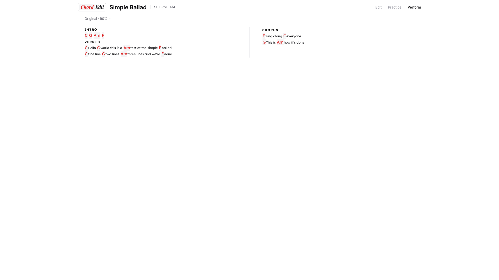
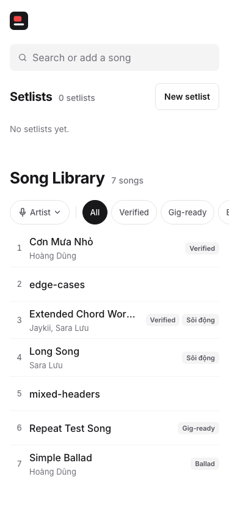

# ChordEdit

A web app for keeping song lyrics with inline chords, and for practising
and performing them. Built for a guitarist playing Vietnamese songs with a
band, from a phone or tablet on stage.

| Song page | Library (phone) |
|---|---|
|  |  |

- **Library**: search, tags, artists, recently played, setlists. Search
  also finds songs on hopamchuan.com and imports them, chords and all.
- **Edit**: tap a word to add or change a chord, tap a section chip to
  label a paragraph, transpose by key; saves as you go. Songs are plain
  text (`[C]lyric` lines, `(Chorus)` headers) with alternate versions.
- **Practice**: audio from YouTube or an uploaded mp3, vocals / backing
  stems (Demucs), speed and pitch, a metronome you tap in to the record.
- **Perform**: lyrics only, big; on a tablet or foldable in landscape,
  two columns turned by a tap, a swipe or a Bluetooth page-turner pedal.
- Works as a Home Screen web app on iOS.

Stack: a small Go `net/http` server (no database: songs are files) and a
vanilla TypeScript frontend bundled by Vite. Tested with Go tests, Vitest
and Playwright.

- [`DEPLOYMENT.md`](DEPLOYMENT.md) — run it on your own server and domain.
- [`CLAUDE.md`](CLAUDE.md) — how it works: features, design system,
  architecture, conventions. Written for coding agents and people alike.
- This file — local development and the test suite.

MIT licensed (see [`LICENSE`](LICENSE)).

## Local development

```bash
npm install                      # Vite, TS, Vitest, Playwright, Tone.js
npx playwright install chromium  # once, for the browser tests
```

Two-server workflow (TS hot reload):

```bash
go run main.go     # terminal 1 — Go backend on :8080
npm run dev        # terminal 2 — Vite on :5173 → open http://localhost:5173/music/
```

Or Go only (serves the last `npm run build` output from `static/dist/`):

```bash
npm run build && go run main.go  # http://localhost:8080/music/
```

Code and content are kept apart: the repo holds no songs. The server
keeps every song, setlist and setting as files in `SONGS_DIR`
(`/var/data/chordedit/songs` in production, `./songs/` by default in
dev, gitignored), so the library survives deploys and is backed up on its
own. The test suite brings its own made-up songs (`tests/fixtures/`).
A dev checkout starts with an empty library. To pull songs from a running server:
`./download-songs.sh ./songs https://<your domain>/music`.
Optional env vars: `YOUTUBE_API_KEY` (video search), `SONGS_DIR`, `PORT`.
The server also reads them from a gitignored `.env` in the repo root
(`KEY=VALUE` lines; real env vars win). DEPLOYMENT.md says how to get a
YouTube API key.

YouTube audio download and stem separation need a Python venv, plus
`ffmpeg` and `node` on the PATH:

```bash
python3 -m venv .venv && .venv/bin/pip install -r deploy/requirements.txt
```

The server uses `.venv/bin/python` by default (override with
`CHORDEDIT_PYTHON`). The first stem separation downloads the Demucs model
(~80 MB) into `~/.cache/torch`.

`/static/` is served with immutable cache headers; `{{asset}}` adds a
content hash that the server recomputes when a file changes, so a rebuilt
bundle or edited CSS shows up on a normal reload. Restart `go run main.go`
after Go changes.

To try the dev server on a phone, open `http://<this computer's LAN IP>:8080/music/`
from the same Wi-Fi.

## Build & deploy

```bash
./build.sh         # npm ci + vite build + go build -o music (local smoke test)
./deploy.sh        # tests/typecheck gates + vite build + ship to your server
./server.sh status # server health
```

`deploy.sh` builds everything locally (Vite bundle + a cross-compiled
Linux binary) and rsyncs only the binary, `static/` and `templates/` to
the server. Ops details in `DEPLOYMENT.md`.

## Test suite

| Command | What | Count |
|---|---|---|
| `go test ./...` | Go unit tests incl. API drift test | — |
| `npm run typecheck` | strict tsc on `src/` + `tests/` | — |
| `npm run test:unit` | Vitest (`src/**/*.test.ts`) | 39 |
| `npm run test:e2e` | Playwright functional (`tests/specs/`) | 186 |
| `npm run test:visual` | Playwright visual, mobile/tablet/laptop/desktop | 4 × 20 |
| `npm run test:all` | all Playwright projects | 264 |
| `npm run test:debug` | Playwright UI mode | |

> Playwright tests load the **built**
> bundle from `static/dist/`, so run `npm run build` after changing `src/`
> or the tests will exercise stale JavaScript.

`deploy.sh` gates on Go tests + typecheck + Vitest only; Playwright is too
slow for the deploy gate, so run it locally before risky changes.

### How the Playwright harness works

- Each worker spawns its own Go server (free port, temp `SONGS_DIR`,
  `CHORDEDIT_TEST_MODE=1`). Stop your dev server first.
- Fixtures: `tests/fixtures/songs/*.txt` + `tests/fixtures/song-meta.json`
  are copied into the worker's `SONGS_DIR` before each test. Add a fixture
  by dropping a `.txt` file there.
- `/music/__test__/reload-state` (test mode only) flushes the in-memory
  stores so each test starts fresh.
- External services (hopamchuan, the YouTube Data API) are stubbed in
  `tests/helpers/visual.ts`. A default-deny rule answers any unstubbed
  external request with HTTP 418 — no test may hit the real network.
  `/music/download-audio` is stubbed to fail by default so the Practice
  panel never shells out to yt-dlp; `tests/helpers/media.ts` has helpers for
  search results, download states, and decodable audio (silent WAV).
- Page objects live in `tests/helpers/pages/`. Use
  `sv.enterEditMode()` / `sv.exitEditMode()`, `sv.setMode('practice')`.

### When a test fails

- **Functional:** `npx playwright show-report`, or
  `npx playwright show-trace test-results/<test>/trace.zip`.
- **Visual:** inspect the expected/actual/diff images in `test-results/`.
  Fix the code if it's a regression; if the change is intentional, run
  `npm run test:visual:update` and review every updated PNG before
  committing. Never blanket-update.
- The 1% full-page tolerance can hide real drift (a stale baseline kept
  "passing" for months). After a UI redesign, refresh everything with
  `npx playwright test --config=tests/playwright.config.ts --update-snapshots=all --project=visual-mobile --project=visual-tablet --project=visual-laptop --project=visual-desktop`
  and review the changed PNGs.

### CI

`.github/workflows/test.yml` (push/PR to `main`): `go build` +
`go test -race`, then `npm ci`, typecheck, Vitest, Vite build, Playwright
functional, Playwright visual. The visual step is `continue-on-error`
because baselines are captured on macOS and CI runs Linux.
